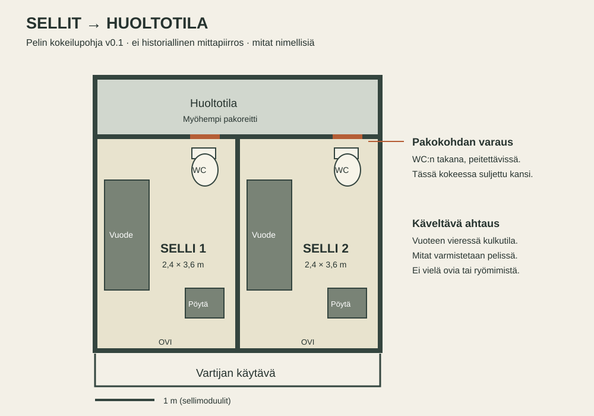

# Vankilan rakenne ja pakoreitti v0.1

14.10.2026. Oma pelillinen rakennelma, ei Alcatrazin historiallinen pohjapiirros. Käyttäjä vahvisti ahtaan sellin ja WC:n taakse sijoittuvan pakoreitin. Alla oleva vankilan ja saaren kokonaisuus on AI:n ehdotus.

## Ensin reitti, sitten rakennuksen yksityiskohdat

Pääreitin ehdotus: **selli → WC:n taakse avattava aukko → suljettu huoltokäytävä → huoltoportaat → työtilan kautta ulos → suojainen rantapaikka → valmisteltu vesipako.** Pakokulkuneuvo ja viimeinen vaihe ovat avoimia. Näin jokainen alue tukee paon valmistelua; saaren koko ei määrää tarvittavaa sisältömäärää.

Huoltoreitti ja tavallinen päiväliikenne pidetään fyysisesti erillään. Pelaajat oppivat ensin näkyvät käytävät ja työalueet. Salainen reitti paljastaa tutun rakennuksen toisen puolen.

Käyttäjän toimittamat [saarikartat ja sellirakennuksen leikkauskuva](references/environments/README.md) säilytetään rakennussuunnittelun pohjana. Leikkauskuvan huoltokäytävät tukevat sellien taakse varattavaa tilaa. Oma työtilan kautta kulkeva pakoreitti on edelleen pelillinen ehdotus: kuvista ei voi vahvistaa sitä historialliseksi reitiksi. Käyttäjän uusi briiffi vahvistaa oman saarivankilan ja loren; Alcatraz on inspiraatio.

## Sellikerroksen ensimmäinen pohja

Ensimmäisessä Unity-rungossa on kaksi selliä ja takana varattu huoltotila. Kuvan aukot ovat suunniteltuja: toteutuksessa ne ovat vielä suljettuja kansipalikoita. Ryömimistä, aukon työstämistä tai pakomekaniikkaa ei ole toteutettu. Kalteriovet ovat ensimmäisessä tilakokeessa avoimia kulkuaukkoja.

| Osa | Kokeiltava mitta | Syy |
|---|---|---|
| Selli | Nimellismoduuli 2,4 × 3,6 m; korkeus 2,8 m | Ahtaus ja käveltävyys. Seinän paksuus vähentää vapaata sisäleveyttä. |
| Vuode | 0,75 × 1,85 m | Kapea, tunnistettava kaluste; jättää kulkureitin. |
| Oviaukko | Noin 1 m tässä kalterikokeessa | 0,6 m leveä testihahmo pääsee läpi ilman pikselintarkkaa ohjausta. |
| Huoltotila | Noin 1,3 m syvä | Antaa taka-aukoille yhteisen tilan; testataan reitin ahtaus ja kohtaaminen. |
| Pakokohta | Lähtövaraus 0,5 × 0,6 m | Vaatii erillisen siirtymis-/ryömimisratkaisun; seisova hahmo ei mahdu. |

WC on pakokohdan edessä, joten suunniteltava toiminto on ensin kansi/kaluste syrjään tai kalusteen kautta pääsy aukkoon. Päätös on avoin. Säilytä peitettävyys ja vartijan tarkastettavuus: työmaa ei saa olla pysyvästi näkymätön. Pelillinen aukko voi olla suurempi kuin alkuperäinen referenssi ilman että koko selli suurenee.

Tarkista omasta kamerasta: ovi → pöytä → WC onnistuu, vuoteen vieressä voi kääntyä, E-toiminto toimii ilman seinän läpi kurkottamista ja vartija voi nähdä peittämättömän jäljen käytävältä. Kahden pelaajan kohtaaminen ja kuiskausten kuuluvuus testataan verkkokokeessa. Tämän jälkeen vertaillaan ahtaampaa moduulia ennen mittojen lukitsemista.

## Koko vankilan alustava tilakartta

| Alue | Tavallinen yhteys | Pelillinen tehtävä |
|---|---|---|
| Sellisiipi | Keskuskäytävä → valvontapiste | Valmistelu, piilotus, tarkastukset ja yörytmi |
| Ruokala | Valvottu reitti sellisiivestä | Sosiaaliset kohtaamiset ja tiedonvaihto |
| Piha | Keskuskäytävän portti | Näkymä saareen, reitin havainnointi ja ryhmän suunnittelu |
| Pesula / työtila | Erillinen valvottu ovi | Materiaalit ja työkalut; pääsy ansaitaan tehtävillä |
| Vartijoiden tilat | Valvontapisteen takana | Valvonnan uskottava lähtöpiste; ei tarvitse kokonaan pelattavaa toimistorakennusta |
| Huoltoreitti | Sellien takaseinä → huoltoportaat → työtila | Salainen eteneminen ja fyysinen yhteys ulos |

Ensimmäisessä suunnitelmassa yksi sellikerros ja yksi työalue riittävät. Kerroksia lisätään vain, jos ne tuottavat uuden yhteistyötilanteen. Lopulliset rakennuskohtaiset pohjapiirrokset tehdään reittitestin jälkeen.

## Saaren alustava rakenne

Saaren korkein kohta: sellirakennus ja piha. Sen alapuolella työ-/huoltorakennus. Tavallinen saapumisreitti: päälaituri → vartioitu rinne → vankilan portti. Pakoreitti: työtilan huolto-ovi → suojattu rinteen reitti → suojainen ranta. Päälaituri ja pakoranta ovat eri puolella rakennusmassaa, jotta tavallinen huolto ja salainen pako eivät ole sama reitti.

Meri, vastaranta ja osa saaresta voivat aluksi olla taustaa. Pelattavaa aluetta on vain siellä, missä pelaaja havainnoi, valmistautuu tai toimii. Saaren muoto ja etäisyydet valitaan peliajan ja näkyvyyden perusteella; ei vielä karttakilometrejä tai avointa maailmaa.

Pakoreitin jokainen linkki tarvitsee esteen, ennakkotiedon ja keinon valmistautua: sellissä ääni/jälki; huoltoreitillä tila ja kulku; työtilassa pääsy ja materiaalit; rannassa lähtöhetki ja väline. Pelkkä pitkä käytävä ei ole oma tehtävä.

## Avoimet päätökset ja seuraavat kokeet

1. Millä tavalla WC:n taakse pääsee ja miten työ peitetään?
2. Näkeekö vartija jäljen oikeasta kulmasta ilman kaikkitietävää tekoälyä?
3. Kulkevatko kaksi pelaajaa huoltotilassa jonossa vai tarvitaanko ohituspaikka?
4. Onko ulosmenoreitti työtilan läpi kiinnostavampi kuin kattoreitti? Katto on vertailuvaihtoehto, ei toinen luvattu pakoreitti.
5. Miten 3–4 pelaajan sellit, työjako ja takaiskut liittyvät samaan reittiin?

Rakentamisjärjestys: kaksi selliä → suljettu huoltotila → vartijatilanne → avattava pakokohta → lyhyt huoltoreittikoe → yksi työtila → rannan koe. Saaren ja vankilan yleiskuva tarkentuu rinnalla; koko saarta ei mallinneta ensimmäiseksi.
