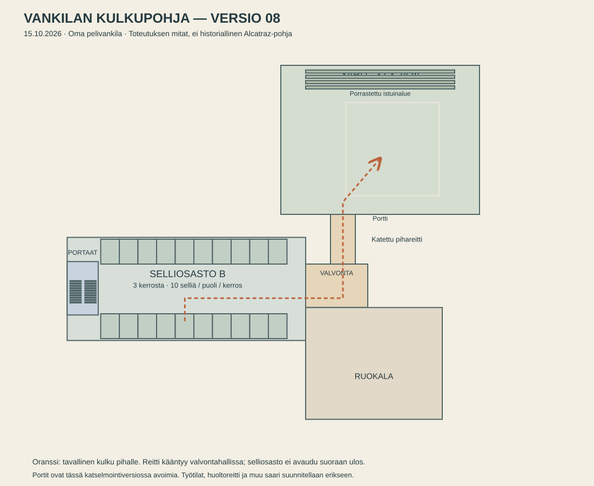

# Vankilan rakenne ja kulkuyhteydet — versio 08

Päivitetty 15.10.2026. Oma saarivankila ja lore. Referenssin arkkitehtoninen rytmi ja toimintojen suhteet ohjaavat suunnittelua; tämä ei ole Alcatrazin tarkka pohja.

[Blueprint erillisenä SVG-tiedostona](layouts/prison-layout-v08.svg). [Vanha kahden sellin koesuunnitelma](PRISON-LAYOUT-v01.md) on säilytetty kehityshistoriana.

## Käyttäjän vahvistama korjaus

Kolme sellikerrosta. Ei suoraa ulko-ovea selliosastolta pihalle. Suurempi yard. Portaat tarvitsevat tilaa ja esteettömän nousuaukon; vanhan välipohjan aiheuttama tukos on rakennusvirhe.

## Nykyinen pelattava rakenne

| Alue | Toteutus versiossa 08 | Päätöksen luonne |
|---|---|---|
| Selliosasto B | 3 kerrosta, 10 selliä kummallakin puolella per kerros, yhteensä 60 selliä | Kolme kerrosta käyttäjän vaatimus; määrä ja mitat AI:n kokeiltava ehdotus. |
| Kerroskäytävät | Noin 1,65 m leveät, päissä poikittaiset yhteydet | Käveltävä rakenne ja pitkä avoin keskitila. |
| Portaat | Avoin noin 5 × 8,6 m päätyalue osaston sisällä; noin 1,95 m portaat, 10 askelmaa per puolikas nousu | AI:n toteutus väljyys- ja kulkuvaatimukseen. |
| Valvontahalli | Osaston itäpäässä, pihareitti kääntyy tässä | Käyttäjän vaatima erillinen valvottu siirtymä; ei vielä toimivaa vartiointijärjestelmää. |
| Pihalle johtava käytävä | Katettu reitti ja kaksi avointa tarkastusporttia | Tavallinen liikenne erotetaan suoraan ulos aukeavasta osastosta. |
| Yard | Noin 32 × 24 m, kenttä, penkkejä ja porrastettu istuinalue | AI:n mitoitusehdotus. Aiempi noin 17,5 × 14 m koe oli liian pieni. |
| Ruokala | Valvontahallista sivuun johtava sisäänkäynti; noin 22 × 18 m | Pelattava yhteys, ei lopullinen keittiö-/ruokalaratkaisu. |

Kerroskorkeus 3,35 m. Sellimoduuli noin 3 × 4 m. Sellirivi on noin 30 m pitkä; päädyissä on lisätilaa. Nämä ovat pelimittakaavan arvoja, eivät historiallisia mittauksia.

Tavallinen kulku: **selli → osaston keskuskäytävä → valvontahalli → kääntyvä katettu siirtymä → portti → yard**. Ruokala erkanee valvontahallista. Portaat ja kerroskäytävät kuuluvat samaan sisäiseen selliosastoon.

Kaikki portit ovat tällä hetkellä avoimia katselmointia varten. Kulkuoikeudet, saattaminen, lukitus ja vartijoiden valvonta eivät vielä toimi. Pelin visuaalinen alue on yksin tutkittava; tämä ei vahvista sen verkkotoimintaa.

## Mikä on vielä myöhempää?

- WC:n takainen pakokohta ja sellien takainen huoltokäytävä eivät vielä muodosta kuljettavaa pakoreittiä.
- Työtilat, sairaala, kirjasto, pesula, keittiön toiminnot ja muut selliosastot tarvitsevat omat pelilliset tehtävänsä ennen rakentamista.
- Saari, päälaituri, rinne ja pakoranta ovat vasta suunnittelua. Meri ja vesitorni ovat taustaa.
- Pakoreitin ehdotus säilyy: selli → huoltoreitti → työ-/huoltoalue → suojainen ranta → lautta tai pieni alus pimeyteen. Tarkka fyysinen reitti ei ole lukittu.

## Mitä tekijältä tarvitaan seuraavaksi?

Nykyiset kuvat riittävät tämän rakennemuutoksen tekemiseen. Seuraavassa katselmoinnissa hyödyllisintä on arvioida oman kameran kautta käytävän pituutta, kolmen kerroksen korkeutta, portaiden väljyyttä ja pihan kokoa. Tarkkoja mittoja, 3D-malleja tai lisää tutkimuskuvia ei tarvitse itse tuottaa.

Kun tämä mittakaava tuntuu oikealta, seuraava suunnittelupäätös on tärkeimpien arjen alueiden ja työreittien sijoittelu. Koko saaren lopullista pohjaa ei tarvita tämän alueen hyväksymiseen.

## Näyttö ja historia

[Ajettavan version kuvat ja kulkutarkistus](evidence/update-08/circulation.txt), [devlog](devlog/2026-10-15-avatars-guards-optimization.md), [uudet referenssit](references/environments/layout-07/README.md).

## Valvonta version 08 pohjassa

Porraskoppi poistui. Porras on osaston avoimessa länsipäädyssä, noin viisi metriä aikaisempaa lähempänä käytävää. Kaksi vartiointipistettä on portaikon ja kerroskäytävän kohdalla; kolmas valvontahallissa. Nämä ovat fyysisesti sijoitettuja hahmoja, eivät vielä toimiva epäily- tai havaintojärjestelmä. Ruokalan keskikäytävä jatkuu sisäänkäynniltä perälle.
