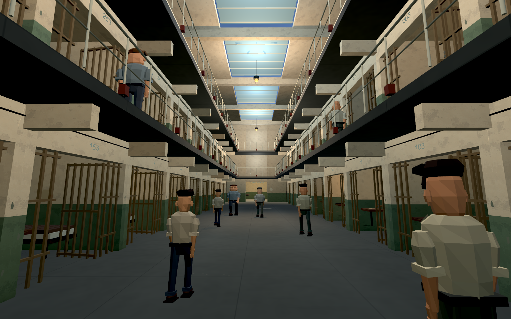
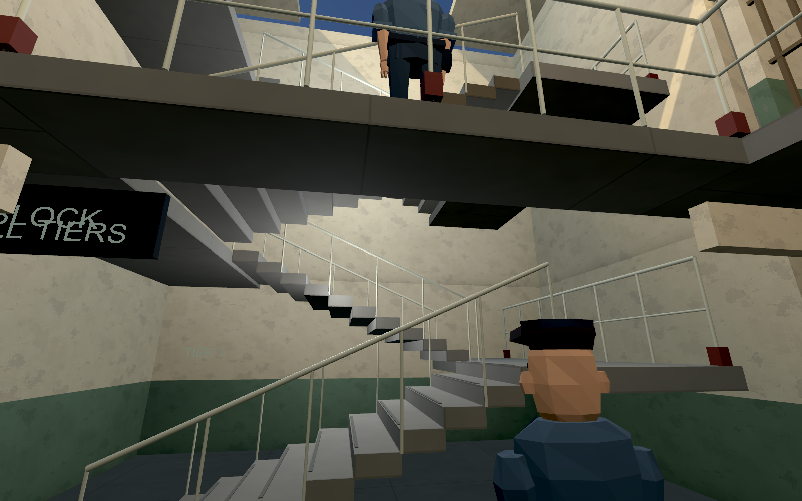
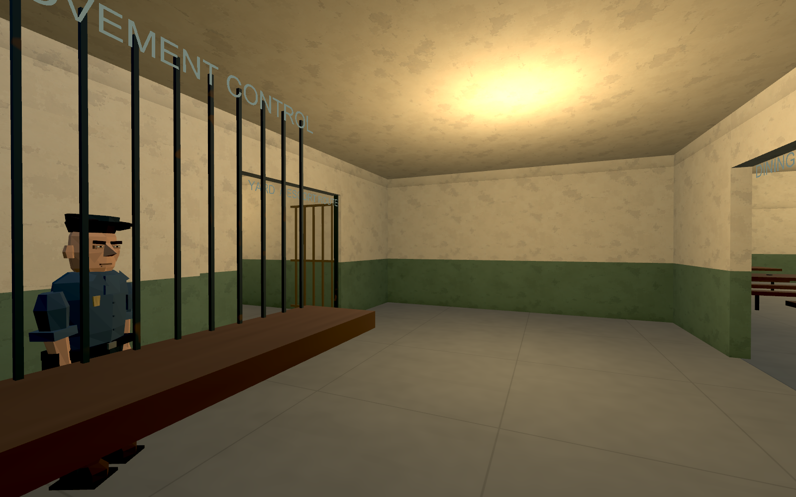
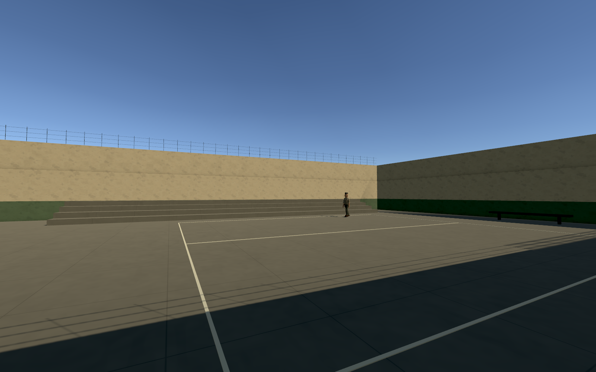

# Visuaalinen pelialku — versio 10

Päivitetty 15.10.2026. Yksin tutkittava vankila-alue. Tämä on rakennuksen, tunnelman ja käveltävyyden katselmointiversio; kampanja, NPC-puhe ja päivärytmi eivät vielä toimi.

## Käynnistäminen

Avaa `unity/PrisonCoop/Builds/macOS/PrisonCoop-10.app`. Sulje aiempi peliversio ennen käynnistystä. Unityssa **Prison Coop → Open Visual Prison** ja Play avaa saman VisualPrison-kohtauksen.

WASD liikkuu, hiiri katsoo, E nostaa tai palauttaa oman sellin viilan. Esc avaa herkkyysasetukset. Mikrofonia tai hostausta ei tarvita.

## Alue ja opastus

- Kolme kerrosta, kymmenen selliä molemmin puolin kerrosta: yhteensä 60 selliä.
- Molemmissa ylemmissä kerroksissa käytävät ja päätyjen poikittaiset yhteydet.
- Portaat ovat osaston avoimessa länsipäädyssä eli omasta sellistä tullessa vasemmalla. **STAIRS / ALL TIERS** -kyltti osoittaa portaikkoon. Nousu kulkee kahdessa syöksyssä lepotasanteen kautta.
- Itäpäädyssä eli oikealla on **MOVEMENT CONTROL** -valvontahalli. Siellä käännytään pihalle tai ruokalaan.
- Pihalle kuljetaan pohjoiseen, katettua käytävää ja avoimia portteja pitkin. Ruokala on valvontahallin vastakkaisella sivulla.
- Yard on noin 32 × 24 m. Siellä on kenttä, penkit ja porrastettu istuinalue.
- 12 liikkuvaa vankia, kahdeksan erilaista ulkoasua ja kolme paikallaan vartioivaa vartijaa.

[Nykyinen blueprint ja mitat](PRISON-LAYOUT.md). Nämä ovat oman pelivankilan kokeiltavat mitat, eivät Alcatrazin historiallinen pohja.

## Ajettavan version kuvat

## Tarkistukset ja rajat

Kohtaus ja Mac-sovellus rakennettu Unity 6000.6.5f1:llä. Kuvat tarkistettiin ajettavasta sovelluksesta. Pelaajan oikealla törmäyskapselilla ajettava kulkutarkistus kirjaa nousun kolmeen kerrokseen, ylimmän kerroksen kierron, laskeutumisen sekä reitin valvontahallin kautta pihalle ja ruokalan perälle. [Kulkutarkistuksen tulokset](evidence/update-08/circulation.txt).

Portit ovat avoimia katselmointia varten, eivät toimivaa kulunvalvontaa. WC:n taakse ei vielä voi paeta. Vesitorni ja meri ovat taustaa. Koko saarta, muita selliosastoja tai työtiloja ei ole rakennettu. Version 08 hahmonäkyvyys tarkistettiin kahdessa paikallisessa prosessissa. Lyhyt renderöinnin ruutuaikakoe kirjataan PERFORMANCE.md:n mukaisesti; se ei ole GPU-profilointi. Mikrofonikoetta ei tehty.

## Jatkokehitys

[Nykyinen projektibriiffi](PROJECT-BRIEF.md), [moduulien vastuut](MODULARITY.md), [version 08 devlog](devlog/2026-10-15-avatars-guards-optimization.md).

Kohtauksen geometria ja materiaalit on tallennettu Unity-asseteiksi. **Rebuild Visual Prison** muodostaa koko kohtauksen lähdekoodista ja varmuuskopioi aiemman kohtauksen Builds/SceneBackups-kansioon; se ei ole tavallinen käynnistyspainike. **Build Visual Mac** tuottaa version 10.

## Pelaajakeho ja paikallinen verkkokoe

Omat kädet näkyvät normaalissa näkymässä; alas katsomalla näkyvät jalat. Raajat ovat ensimmäinen animaatiokoe. Toinen pelaaja näkyy kokonaisena hahmona. H käynnistää hostin ja J liittyy samalla koneella olevaan hostiin; host pitää aloittaa ensin. Yhteys on edelleen vain paikallinen prototyyppi, ei Steam tai eri koneiden verkko. Kahdessa erillisessä prosessissa tarkistettu hahmonäkyvyys ei vielä synkronoi koko NPC-maailmaa.

Ruokala on noin 22 × 18 m. Vartijat ovat sijoiteltuina valvontaan mutta eivät vielä reagoi rikkomuksiin.

[Suorituskyvyn käytäntö ja mittauksen rajat](PERFORMANCE.md). Builds/macOS-kansiossa säilytetään vain uusin tarkistettu sovellus.

## Version 09 animaatiot

Kävely seuraa kuljettua nopeutta. Polvet, nilkat, käsivarret ja rintakehä liikkuvat eri vaiheissa, ja liikkeellelähtö/pysähtyminen pehmenee. Omat kädet ovat rennosti sivuilla; alas katsoessa näkyvät myös paita, vyö ja lantio. Vain oma pää piilotetaan. Aiempi version 08 ylävartalon piilotus on korvattu tällä.

Hahmot käyttävät edelleen nivelöityjä jäykkiä osia. Tämä ei ole vielä lopullinen skinnattu animaatiorigi eikä portaiden terrain-IK. Testikuvat ja kahden paikallisen pelaajan tarkistus: `evidence/update-09`.

## Version 10 ulkoasu
Hahmojen kasvojen pinnat, hiukset, hihat, housut ja kädet on muotoiltu lähemmäs alkuperäistä referenssiä. Vaatteiden pääpaletti on haalistunut siniharmaa, mukana hillittyjä työvaatevariaatioita. Uudet lähikuvat: `evidence/update-10/portrait-0.png`–`portrait-3.png`.
